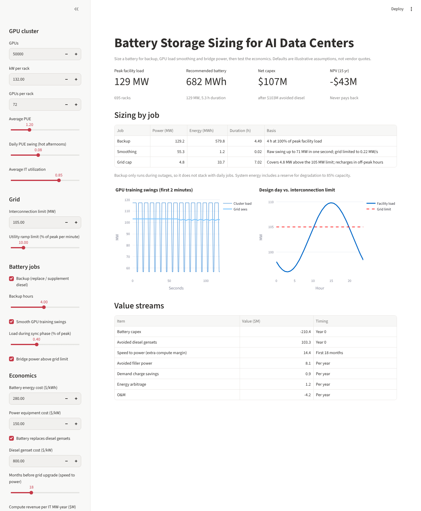
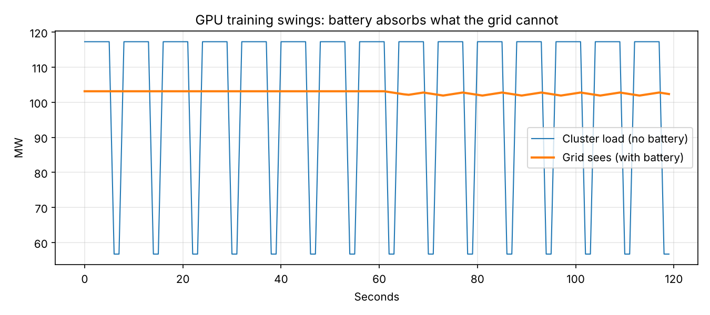
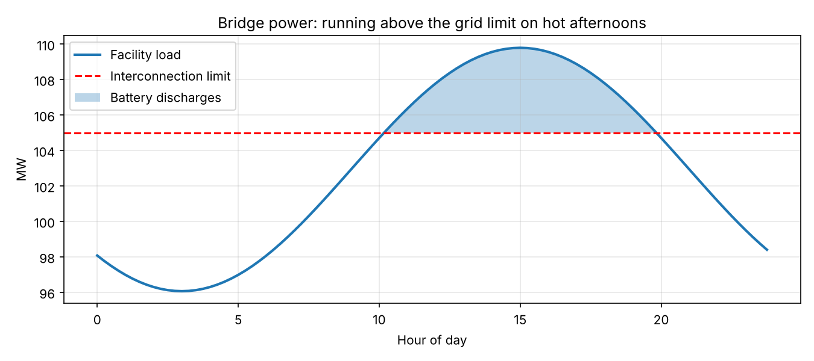

# Battery Storage Sizing for AI Data Centers

**AI is now power-constrained.** New GPU campuses wait years for grid connections, rack densities have climbed past 100 kW, and synchronized training jobs swing the load of an entire cluster by tens of megawatts in about a second. Battery energy storage (BESS) can help with all three problems, but only if it is sized for the right job.

This tool sizes a battery for a GPU cluster and tests whether it pays off.



## What it does

Given a cluster (GPU count, rack power, PUE) and a grid connection (MW limit, ramp limit), the model sizes a battery for three jobs:

| Job | Problem | What sets the size |
|---|---|---|
| **Backup** | Diesel generators are slow to permit and emit on site | Hours of outage cover × facility load |
| **Load smoothing** | Training jobs swing between full and partial power every few seconds; utilities limit how fast load may change | Peak power gap between the swinging load and a ramp-limited grid |
| **Bridge power** | The campus is ready before the utility can deliver full capacity | Energy above the interconnection limit on the hottest day, *if* it can be recharged off-peak |

It then values the battery: avoided diesel capex, speed to power (extra compute revenue before a grid upgrade), avoided "filler" power, demand charges and arbitrage. The outputs are NPV, payback and LCOS (levelized cost of storage).

## Findings: 50,000-GPU campus, ~129 MW peak facility load

| Scenario | Battery | Net capex | NPV (15 yr) | Payback |
|---|---|---|---|---|
| **A.** Replace diesel (4 h) + bridge + smoothing | 129 MW / 682 MWh | $107M | **–$43M** | never |
| **B.** Keep diesel; battery for bridge + smoothing | 60 MW / 41 MWh | $21M | **+$66M** | ~1.2 yrs |
| **C.** Scenario A at $200/kWh battery cost | 129 MW / 682 MWh | $52M | **+$21M** | ~5.4 yrs |

1. **The best first battery is a short, high-power one.** Smoothing GPU swings needs about 55 MW but only about 1 MWh. Battery chemistry (C-rate), not energy, sets the size, and the payback comes from not burning filler power and from energizing earlier.
2. **Fully replacing diesel doesn't pay at today's prices.** Four hours at full campus load means about 680 MWh. It turns positive at roughly $200/kWh, so the decision depends on the cost curve, not just the engineering.
3. **A battery cannot bridge a sustained shortfall.** If *average* load is above the grid limit, the battery never recharges. The model flags this. Bridge power works for daily peaks; a sustained gap needs on-site generation or a phased cluster.
4. **Speed to power is the dominant value lever.** Every month an MW of GPU capacity sits idle waiting on the utility costs far more than the battery's energy economics recover.




## Run it

```bash
pip install -r requirements.txt
streamlit run app.py        # interactive tool
python run_example.py       # three scenarios + charts in docs/
python -m pytest            # model tests
```

## How the model works

```
bess_model/
  config.py     every assumption, with a comment on what it means
  load.py       daily (15-min) and training-swing (1-second) load profiles
  sizing.py     power + energy for each job, combined into one system
  economics.py  value streams, NPV, payback, LCOS
```

- **Stacking:** smoothing and bridge power run together every day, so they add. Backup only runs during outages, so it doesn't stack with them.
- **Smoothing controller:** the grid follows a 60-second rolling average of the load, limited by the utility ramp rate. The battery covers the difference.
- **No double counting:** arbitrage only uses capacity that no other job has claimed. Most of the backup energy stays reserved for outages.
- **Degradation:** energy is oversized so the battery still meets its duty at 85% end-of-life capacity. Power is checked against a maximum C-rate.

## Assumptions and limits

Default costs and prices are **illustrative round numbers, not quotes**. Change them in the sidebar or in `config.py`. Not yet modeled: hourly market prices, multi-year degradation curves, the cost of the grid upgrade itself, tax credits (ITC), alternatives to batteries for smoothing (supercapacitors, GPU-level power smoothing), and the cost of a GPU outage beyond the backup duration.

## About

Built by **Sai Karri**, a PMP-certified project manager who delivers utility-scale and C&I battery storage projects and is moving into AI data center power infrastructure. Companion project: [Solar PV & inverter sizing tool](https://github.com/saiskarri-svg/solar-inverter-sizing).
